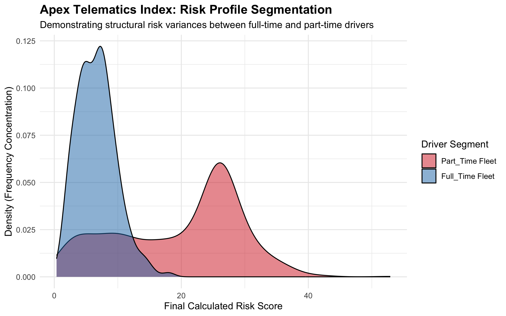

# Ride-share Telematics Risk Index
Actuarial data and pricing process built across Python, SQL, and R

* **Python (Numpy, Pandas):** Simulated 1000 driver profiles utilizing specific statistical distributions to model real-world behavioral risk in part-time and full-time rideshare drivers.
* **SQL (SQLite Engine via Python):** Cleaned missing data and executed data transformation queries using localized column vectorization and segment modifiers.
* **R (ggplot2):** Conducted quantile distributions to establish a 3-tier risk pricing model and exported relevant data visualizations.
  * Split risk pool into Preferred (Bottom 30%), Standard (Middle 50%), and High Risk (Top 30%).
 

